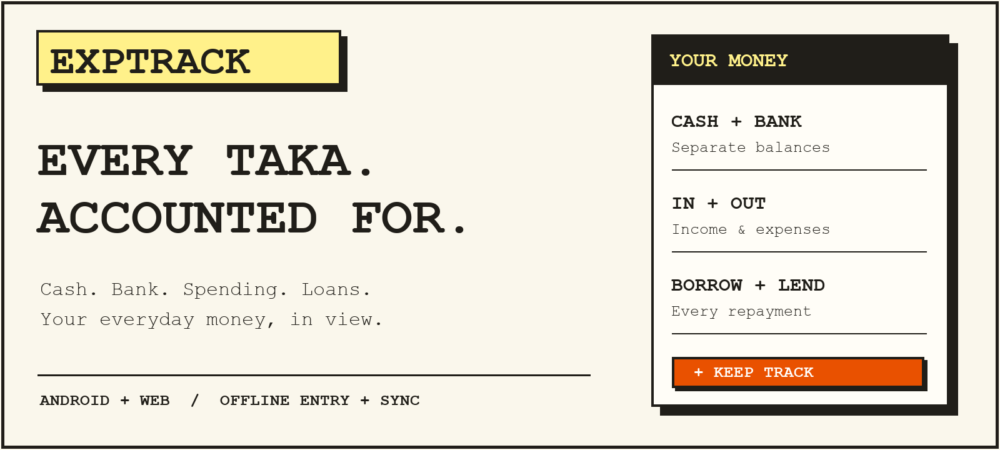

<p align="center">
  
</p>

<p align="center">
  <a href="https://github.com/fakhrul62/expense-track/raw/refs/heads/main/android-offline-app/dist/EXPTRACK-1.11.3.apk"></a>
  <a href="https://expense-track-lovat.vercel.app"></a>
</p>

<p align="center">
  <strong>v1.11.3</strong> · Android 7.0+ · System WebView 111+<br>
  <a href="#get-started">Installation</a> · <a href="android-offline-app/VALIDATION-1.11.3.md">Release notes</a> · <a href="android-offline-app/README.md">Developer guide</a>
</p>

---

## A little order for everyday money.

Salary arrives. Groceries happen. A friend pays back part of a loan. **EXPTRACK keeps the record** with separate cash and bank balances, quick expense entry and reports you can actually read.

Cream paper, bold borders, orange controls and hard shadows give it its retro character. Choose a different theme and font in Config to make it yours.

<table>
<tr>
<td width="50%" valign="top">

### `+` MONEY IN

Record salary, freelance income and other money received. Choose **Cash** or **Bank** to keep each balance clear.

</td>
<td width="50%" valign="top">

### `−` MONEY OUT

Add one expense or a whole batch. Choose the payment source, then browse entries as a **list or grid**.

</td>
</tr>
<tr>
<td width="50%" valign="top">

### `↔` BORROW & LEND

Track **I Owe** and **Owed to Me**, including installments, full settlements and mistaken-entry deletion.

</td>
<td width="50%" valign="top">

### `▥` SEE THE PATTERN

Compare income and expenses by **day, week, month or custom dates**. Explore charts and categories, export CSV or print to PDF.

</td>
</tr>
</table>

### Small details. Everyday convenience.

- **Offline on Android** — record entries locally and sync when connected.
- **Your account, both screens** — Google or email sign-in across Android and web.
- **Reminders on your schedule** — choose one to six daily notification times.
- **Make it comfortable** — coordinated themes, font choices, light and dark modes.
- **Updates within reach** — a subtle Config badge signals a newer app version. The updater is the first settings tab.

## Get started

**1 · Download** the latest APK using the orange button above.

**2 · Install** it on your Android phone. Allow installation from your browser or file manager when Android prompts you.

**3 · Sign in** with Google or create an email/password account, then add your first income or expense.

Google sign-in on Android requires Google Play services. Install updates over your existing app to retain local records. Future releases are available through **Config → Updates**. [APK checksum](android-offline-app/dist/EXPTRACK-1.11.3.apk.sha256) · [Update guide](android-offline-app/UPDATES.md)

<details>
<summary><strong>How balances, loans and sync work</strong></summary>

### Cash and bank

Income adds to its selected balance. Expenses deduct from their selected balance and default to cash.

### Borrowing and lending

Money borrowed adds to the selected balance. Money lent or repaid reduces it. Collections add money back. Outstanding debt and receivables are tracked separately. Existing obligations can be recorded without counting a historical money movement again.

### Offline and sync

After sign-in, Android stores entries in private SQLite storage. Pending changes sync while the app is open and connected, including after reconnecting or resuming. Use the same account on the website to see synced records.

Keep the app installed until pending entries finish syncing. Clearing app data or uninstalling can remove unsynced records. Background uploads require the app to resume. [Storage and sync details](android-offline-app/README.md#storage-and-sync)

</details>

<details>
<summary><strong>Under the hood · stack, setup & repository</strong></summary>

**Next.js 16 / React 19 / TypeScript / Tailwind CSS 4**<br>
**Capacitor 8 / SQLite / IndexedDB / MongoDB Atlas / Vercel**

### Local development

Use Node.js 24 and npm, plus a MongoDB connection for the account and sync API.

```bash
git clone https://github.com/fakhrul62/expense-track.git
cd expense-track/android-offline-app
npm ci
cp .env.example .env.local
```

Set `MONGODB_URI` in `.env.local`. Set `GOOGLE_CLIENT_ID` to enable Google sign-in; see [Google setup](android-offline-app/GOOGLE-SETUP.md). Keep these settings on the server.

```bash
npm run dev
```

Open [localhost:3000](http://localhost:3000). For Android builds, signing, tests and deployment settings, use the [developer guide](android-offline-app/README.md).

### Repository layout

The maintained Android app, web app and API are in **[`android-offline-app/`](android-offline-app/)**. Vercel uses this folder as its project root.

- [`src/`](android-offline-app/src/) — interface, account API, local ledger and sync logic.
- [`android/`](android-offline-app/android/) — native Android project and integrations.
- [`dist/`](android-offline-app/dist/) — versioned signed APKs and checksums.
- [`scripts/`](android-offline-app/scripts/) — build tools and regression checks.
- [`docs/qc/`](android-offline-app/docs/qc/) — QC findings, fixes and test scope.

Earlier website files are retained at the repository root. Start in `android-offline-app` for current development.


</details>

---

<p align="center">
  <strong>EXPTRACK</strong><br>
  Built by <a href="https://github.com/fakhrul62">Md. Fakhrul Alam Shuvo</a><br>
  <a href="https://github.com/fakhrul62/expense-track/issues">Report an issue</a> · <a href="android-offline-app/README.md">Build it yourself</a>
</p>
